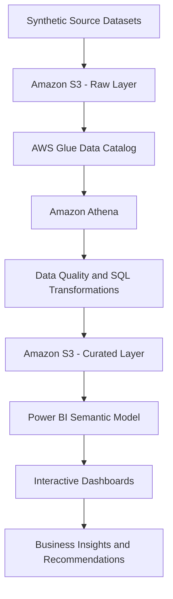
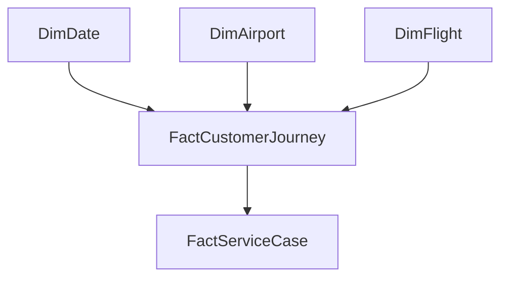

# ✈️ Airline Customer Experience Analytics

**End-to-End Business Intelligence | Data Modelling | Python | SQL | Power BI | AWS**

An end-to-end analytics portfolio project investigating passenger satisfaction, flight delays, disruptions, complaints, service recovery and route performance. The project demonstrates how raw operational data can be transformed into validated analytical datasets, business intelligence metrics and actionable recommendations.

> **Project data:** Synthetic passenger and operational data created for portfolio and analytical demonstration. Results do not represent actual airline performance.

## 📌 Project Overview

Airlines operate in a complex environment where flight punctuality, disruption management, baggage handling and service recovery can influence passenger experience.

This project explores customer-experience patterns across 50,000 synthetic passenger journeys covering July 2025 to June 2026. It combines data quality assessment, Python-based analysis, SQL investigations, dimensional modelling and interactive Power BI reporting.

The objective is to demonstrate an analytical workflow from source data through data preparation and modelling to business insights and operational recommendations.

## 🎯 Business Objectives

- Establish a baseline for passenger satisfaction, complaints and flight disruptions.
- Investigate how delay severity relates to customer satisfaction and complaint rates.
- Analyse baggage issues and their association with passenger outcomes.
- Evaluate customer-service case status, resolution duration and compensation.
- Compare customer outcomes across passenger segments and routes.
- Develop clear KPIs and recommendations for operational decision-making.
- Design a scalable cloud analytics architecture using Amazon S3, AWS Glue Data Catalog and Amazon Athena.

## 📊 Dataset Overview

The project uses four synthetic datasets.

| Dataset | Records | Analytical purpose |
|---|---:|---|
| Customer Journey | 50,000 | Passenger journey attributes, delays, disruptions, satisfaction and complaints |
| Airport Reference | 27 | Airport identifiers and reference attributes |
| Flight Schedule | 29,200 | Flight schedule and route information |
| Service Cases | 878 | Customer-service cases, status, resolution and compensation |

**Reporting period:** 1 July 2025 – 30 June 2026.

The datasets were designed to support descriptive analytics, KPI development, statistical investigation and dashboard reporting.

All datasets are synthetic. They must not be interpreted as actual passenger records or real airline operational results.

## 🏗️ Solution Architecture

The solution is organised into four analytical layers.

1. **Source data:** Customer journeys, airport reference data, flight schedules and service cases.
2. **Data engineering:** Data inspection, validation, cleaning, key matching and analytical preparation.
3. **Analytics and modelling:** Python statistical analysis, SQL queries, dimensional modelling and KPI definitions.
4. **Business intelligence:** Power BI dashboards, executive reporting and business recommendations.

### Proposed AWS data pipeline

The target cloud architecture uses AWS services to provide a structured and scalable analytics workflow.



**Pipeline design**

| Layer | Technology | Responsibility |
|---|---|---|
| Source | CSV / Excel datasets | Provide journey, airport, schedule and service-case data |
| Raw storage | Amazon S3 | Store source files in a controlled raw-data location |
| Metadata | AWS Glue Data Catalog | Register tables, schemas, columns and storage locations |
| Query processing | Amazon Athena | Run SQL queries against data stored in S3 |
| Curated storage | Amazon S3 | Store validated and transformed analytical outputs |
| Reporting | Power BI | Present KPIs, trends, comparisons and business insights |

The proposed pipeline separates raw source data from curated analytical outputs. Data-quality checks should be applied before curated datasets are published for reporting.

**Implementation status:** The diagram describes the target architecture, not proof of a deployed AWS pipeline. Mark each service as implemented only after the corresponding configuration, queries and outputs have been tested.

## 🧩 Data Modelling and Dimensional Design

A reliable analytical model is essential for consistent KPI calculations, filtering and reporting across multiple business dimensions.

The proposed reporting model uses a **star-schema approach**, with journey-level measures separated from service-case-level measures.

### Conceptual logical model



This is a conceptual model showing the intended analytical entities and relationships. The final Power BI model must be based on verified source keys, table grain and relationship cardinalities.

### Proposed model components

| Table | Grain | Purpose |
|---|---|---|
| `FactCustomerJourney` | One row per passenger journey | Stores journey-level operational attributes and customer outcomes |
| `DimDate` | One row per calendar date | Supports daily, monthly, quarterly and yearly analysis |
| `DimAirport` | One row per airport | Supports airport and country-level comparisons |
| `DimFlight` | One row per defined flight or schedule entity | Supports flight and route analysis |
| `FactServiceCase` | One row per service case | Stores case status, resolution and compensation information |

The conceptual model should be refined after validating the actual source data and join keys.

### Data modelling principles

- **Define table grain:** Identify exactly what one row represents in every table.
- **Use stable keys:** Validate primary and foreign keys before creating relationships.
- **Handle unmatched records:** Investigate flight-number and route mismatches rather than forcing unreliable joins.
- **Avoid fan-out:** Do not join multiple service cases directly to journeys in a way that duplicates journey counts or satisfaction measures.
- **Separate measures by grain:** Calculate journey-level KPIs from journey records and service-case KPIs from case records.
- **Use a date dimension:** Support consistent time filtering and month-on-month comparisons.
- **Document relationships:** Record relationship cardinality, filter direction and key columns in Power BI Model view.

### Power BI semantic model

The Power BI semantic model is intended to provide consistent business definitions for:

- Total passenger journeys
- Average satisfaction score
- Complaint rate
- Disruption rate
- Average delay in minutes
- Satisfaction by delay band
- Complaint rate by delay band
- Service-case volume and status
- Compensation rate
- Service-case resolution duration

DAX measures should explicitly define their numerator, denominator and filter context. Power Query should handle appropriate data preparation, while relationships and measures should support consistent analysis across dashboard pages.

**Note:** The tables above describe the proposed model. Confirm that the actual Power BI file implements these structures before presenting them as completed technical work.

## 📈 Key Findings

Initial analysis of the synthetic dataset produced the following baseline metrics.

| KPI | Result |
|---|---:|
| Passenger journeys | 50,000 |
| Average customer satisfaction | 3.74 / 5 |
| Overall complaint rate | 12.04% |
| Disruption rate | 12.10% |

Additional descriptive analysis identified the following patterns:

- Passenger satisfaction was lower among journeys experiencing disruptions.
- Complaint rates increased across more severe delay bands.
- Journeys delayed by more than 60 minutes showed substantially poorer customer outcomes.
- Service-case status and resolution analysis identified open and pending cases for further investigation.
- Route comparisons require appropriate sample sizes and validated flight matching.

These findings are descriptive associations within synthetic data. They do not establish causation or represent actual airline performance.

## 📊 Power BI Dashboard

The Power BI report contains five analytical pages.

| Page | Focus | Business question |
|---|---|---|
| Executive Overview | Core KPIs | What is the overall customer-experience baseline? |
| Flight Disruption & Delay Analysis | Delays and disruptions | How do operational disruptions relate to customer outcomes? |
| Customer Complaints & Service Recovery | Complaints and cases | Where should customer-service teams investigate further? |
| Passenger Experience & Segmentation | Passenger and service segments | How do outcomes vary across available segments? |
| Route Performance & Customer Impact | Route comparisons | Which routes warrant additional investigation? |

The executive presentation also summarises the business problem, findings, recommendations and action plan.

**Dashboard file:** [`powerbi/Airline_Customer_Experience_Analytics.pbix`](powerbi/Airline_Customer_Experience_Analytics.pbix)

**Executive presentation:** [`presentation/Airline_Customer_Experience_Analytics.pptx`](presentation/Airline_Customer_Experience_Analytics.pptx)

The `.pbix` file can be opened using Power BI Desktop. GitHub stores the file but does not render it as an interactive Power BI report.

## 🐍 Python Analytics

The `python/` directory contains scripts for data loading, inspection, validation, statistical analysis and visualisation.

Areas covered include:

- Data inspection and validation
- Disruption analysis
- Delay analysis
- Complaint analysis
- Baggage analysis
- Cabin-class analysis
- Multivariable analysis
- Complaint-risk analysis
- Analytical visualisation
- Data export preparation for Athena

### Python setup

**Prerequisites:** Python 3.13 or another compatible version supported by the installed packages.

Clone the repository:

```bash
git clone https://github.com/faisalnchoban786/airline-customer-experience-analytics.git
cd airline-customer-experience-analytics
```

Create a virtual environment:

```bash
py -m venv .venv
```

Activate it on Windows PowerShell:

```powershell
.venv\Scripts\Activate.ps1
```

Install dependencies:

```bash
py -m pip install -r python/requirements.txt
```

### Prepare the data

Place the source datasets in the locations expected by the scripts. Review each script's input paths and configuration before execution.

The public repository does not need to contain all source datasets if they are large or unnecessary for reviewing the code. Any distributed data must be clearly identified as synthetic.

### Run data-quality checks

The following commands are examples, subject to each script's supported execution pattern and configuration:

```bash
py python/data_inspection.py
py python/data_validation.py
py python/run_data_quality.py
```

### Run analytical scripts

For example:

```bash
py python/01_disruption_analysis.py
py python/02_delay_analysis.py
py python/03_complaint_analysis.py
```

Review the scripts' expected inputs and outputs before execution. These commands should be tested from the repository root before being described as fully reproducible.

## 🗄️ SQL Analytics

The `sql/` directory contains SQL scripts for structured analytical investigations, including:

- Data-quality checks
- Disruption analysis
- Delay severity analysis
- Complaint and baggage analysis
- Cabin-class and passenger-segment analysis
- Multivariable analysis
- Complaint-risk investigation
- Monthly trends and route performance

The scripts should be executed in a compatible SQL environment. If Amazon Athena is used, the corresponding database, tables and Glue Data Catalog metadata must first be configured, and any environment-specific SQL or table references must be verified.

**Important:** The presence of SQL scripts in GitHub does not by itself establish that they have been executed in Athena.

## ☁️ AWS Implementation Roadmap

The target AWS implementation consists of the following stages.

1. **Create S3 storage:** Establish separate raw and curated prefixes or buckets with appropriate access controls.
2. **Upload source datasets:** Store the synthetic datasets in a documented file format and folder structure.
3. **Register schemas:** Create or configure Glue Data Catalog databases and tables.
4. **Validate source data:** Check schemas, nulls, duplicate keys and data types.
5. **Query with Athena:** Execute SQL for analysis and transformations.
6. **Publish curated outputs:** Store validated results in S3 in a query-efficient format such as Parquet where appropriate.
7. **Connect reporting:** Configure Power BI to consume validated analytical outputs using a supported connection method.
8. **Operationalise:** Add refresh procedures, logging, monitoring, permissions and cost controls.

### AWS status tracker

| Component | Status |
|---|---|
| Amazon S3 raw-data storage | Planned until verified |
| AWS Glue Data Catalog | Planned until verified |
| Amazon Athena queries | Planned until verified |
| Curated S3 datasets | Planned until verified |
| Power BI integration with AWS outputs | Planned until verified |
| Automated refresh and monitoring | Future enhancement |

Update this table as each stage is implemented and tested.

## 💼 Business Recommendations

The synthetic analysis suggests several areas worth investigating with real operational data:

1. **Delay management:** Review long-delay journeys and the associated deterioration in customer outcomes.
2. **Disruption communication:** Evaluate passenger communication and service recovery during disruptions.
3. **Case management:** Monitor unresolved cases, ageing and resolution performance using clearly defined service-level metrics.
4. **Baggage experience:** Investigate the association between baggage issues, complaints and satisfaction.
5. **Route monitoring:** Compare routes using validated joins and adequate sample sizes.
6. **KPI governance:** Standardise definitions and refresh procedures so that operational teams use consistent metrics.

These recommendations are hypotheses for further investigation, not evidence that a specific intervention will improve real-world outcomes.

## 🔍 Data Quality and Limitations

- All datasets are synthetic.
- Data-quality validation is necessary before analytical results are used.
- Flight-number and route mismatches can affect route-level comparisons.
- Unresolved service cases require careful treatment in resolution-time calculations.
- Multiple service cases can relate to a single journey, so table grain must be respected.
- Correlation and descriptive comparisons do not prove causation.
- AWS components must be verified before being described as deployed.
- Python execution commands and source paths must be tested for reproducibility.

## 🚀 Future Enhancements

- Implement and test the S3–Glue–Athena pipeline.
- Publish validated, curated datasets for downstream reporting.
- Document the actual Power BI schema, relationships and DAX measures.
- Add automated data-quality checks and reproducible outputs.
- Add dashboard screenshots for recruiters who cannot open Power BI Desktop.
- Introduce scheduled data refresh and operational monitoring.
- Extend the analysis with validated statistical tests and carefully evaluated predictive models.

## 📁 Repository Structure

```text
airline-customer-experience-analytics/
├── README.md
├── powerbi/
│   ├── README.md
│   └── Airline_Customer_Experience_Analytics.pbix
├── presentation/
│   ├── README.md
│   └── Airline_Customer_Experience_Analytics.pptx
├── python/
│   ├── README.md
│   ├── requirements.txt
│   └── Python analysis and validation scripts
└── sql/
    ├── README.md
    └── SQL analysis scripts
```

## 🧰 Technologies

- Python, pandas and NumPy
- SciPy, statsmodels and scikit-learn
- SQL
- Power BI, DAX and Power Query
- Amazon S3, AWS Glue Data Catalog and Amazon Athena — planned architecture unless otherwise documented

## 👤 Project Purpose

This independent portfolio project demonstrates the application of data engineering principles, analytical modelling, statistical investigation and business intelligence to a customer-experience problem.

It is designed to showcase technical implementation, analytical thinking and the ability to translate data into business-facing insights.

**Disclaimer:** This project uses synthetic data and is not affiliated with, endorsed by or representative of any specific airline.
