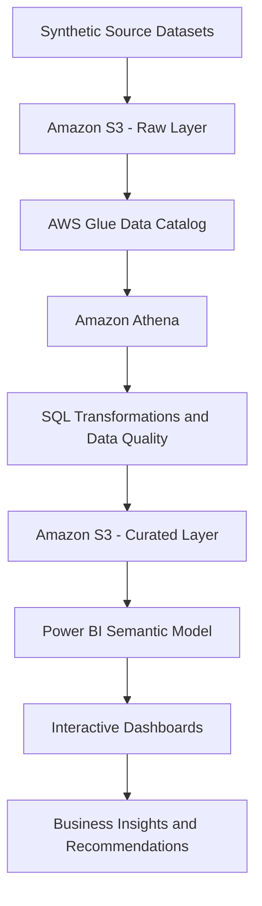

# ✈️ Airline Customer Experience Analytics

**End-to-End Business Intelligence | Data Modelling | Python | SQL | Power BI | AWS**

An end-to-end analytics portfolio project investigating passenger satisfaction, flight delays, disruptions, complaints, service recovery and route performance. The project demonstrates how operational data can be transformed into validated analytical outputs, business intelligence metrics and actionable recommendations.

> **Data disclaimer:** This project uses synthetic passenger and operational data for portfolio and analytical demonstration. The results do not represent actual airline performance.

## 📌 Project Overview

Airlines need to understand where customer experience deteriorates, which operational issues are associated with complaints, and where service improvements may have the greatest impact.

This project analyses 50,000 synthetic passenger journeys covering **1 July 2025 to 30 June 2026**. It combines data inspection, validation, Python-based statistical analysis, SQL investigations, Power BI data modelling, KPI development and interactive dashboard reporting.

The objective is to demonstrate an analytical workflow from source data and data preparation through dimensional modelling and reporting to business recommendations.

## 🎯 Business Objectives

- Measure passenger satisfaction, complaint rates and disruption rates.
- Investigate the relationship between delay severity and customer outcomes.
- Analyse baggage issues and their association with complaints.
- Evaluate service-case status, resolution duration and compensation.
- Compare customer outcomes across passenger segments and routes.
- Develop consistent KPIs and actionable operational recommendations.
- Design a scalable cloud analytics pipeline using Amazon S3, AWS Glue Data Catalog and Amazon Athena.

## 📊 Dataset Overview

The project uses four synthetic datasets.

| Dataset | Records | Analytical purpose |
|---|---:|---|
| Customer Journey | 50,000 | Passenger journeys, satisfaction, delays, disruptions and complaints |
| Airport Reference | 27 | Airport identifiers and descriptive attributes |
| Flight Schedule | 29,200 | Flight schedule and route information |
| Service Cases | 878 | Customer-service cases, statuses, resolution and compensation |

**Reporting period:** July 2025 – June 2026.

The datasets support descriptive analytics, KPI development, statistical investigation and interactive reporting.

All records are synthetic. The analysis should not be interpreted as evidence of actual airline or passenger performance.

## 🏗️ Solution Architecture

The analytical solution is organised into four layers:

1. **Source data:** Passenger journeys, airport reference data, flight schedules and service cases.
2. **Data preparation:** Inspection, validation, cleaning, key matching and analytical preparation.
3. **Analytics and modelling:** Python analysis, SQL investigations, dimensional modelling and KPI definitions.
4. **Business intelligence:** Power BI dashboards, executive reporting and operational recommendations.

### Proposed AWS data pipeline

The target cloud architecture uses AWS services to provide a structured workflow for data ingestion, metadata management, SQL processing and reporting.



### Pipeline components

| Layer | Technology | Responsibility |
|---|---|---|
| Source | CSV / Excel datasets | Supply journey, airport, schedule and service-case data |
| Raw storage | Amazon S3 | Store source files in a structured raw-data location |
| Metadata | AWS Glue Data Catalog | Maintain table schemas, columns and storage metadata |
| Query processing | Amazon Athena | Execute SQL queries against data stored in S3 |
| Curated storage | Amazon S3 | Store validated, transformed analytical outputs |
| Reporting | Power BI | Present KPIs, trends, comparisons and recommendations |

The intended design separates raw source data from curated analytical outputs. Data-quality checks should be applied before curated datasets are made available to reporting.

**Implementation status:** This is the proposed AWS architecture. S3 ingestion, Glue catalog configuration, Athena execution, curated outputs and Power BI integration must be verified before being described as implemented.

## 🧩 Power BI Data Modelling

The Power BI report contains a multi-table analytical model that organises passenger journeys, service cases, flight schedules, airport attributes, routes and reporting dates.

The model separates journey-level and service-case-level facts from descriptive dimensions, supporting structured filtering, KPI calculations and business analysis.

### Fact tables

| Table | Purpose |
|---|---|
| `fact_customer_journey` | Contains passenger journey attributes, satisfaction scores, delay minutes, disruption and complaint indicators, and service-experience metrics. |
| `fact_service_case` | Contains service-case information, including case type, status, resolution duration and compensation indicators. |

### Dimension tables

| Table | Purpose |
|---|---|
| `dim_date` | Provides calendar attributes for date filtering and time-series analysis. |
| `dim_journey` | Provides journey identifiers for linking journey-related records. |
| `dim_flight_schedule` | Contains flight numbers, schedule dates, routes, scheduled departure and arrival times, and other schedule attributes. |
| `dim_route` | Provides route identifiers and origin/destination combinations for route-level analysis. |
| `dim_origin_airport` | Provides descriptive attributes for origin airports. |
| `dim_destination_airport` | Provides descriptive attributes for destination airports. |

### Business action table

| Table | Purpose |
|---|---|
| `executive_action_plan` | Organises findings into priorities, recommended actions, review frequency and success metrics. |

These table names reflect the Power BI Model view shared for this project.

### Power BI Relationship Model

The Power BI semantic model organises passenger journeys, service cases, flight schedules, routes, airports and reporting dates into a connected analytical structure.

The model includes the following tables:

- **Fact tables:** `fact_customer_journey`, `fact_service_case`
- **Dimensions:** `dim_date`, `dim_journey`, `dim_flight_schedule`, `dim_route`, `dim_origin_airport`, `dim_destination_airport`
- **Business action table:** `executive_action_plan`

The relationship design supports time-based analysis, airport and route comparisons, flight analysis, customer-experience KPIs and service-case reporting.

Key modelling considerations include:

- Validate primary and foreign keys before establishing relationships.
- Confirm relationship cardinality and cross-filter direction in Power BI Model view.
- Keep journey-level and service-case-level measures at their correct grains.
- Avoid double-counting passenger journeys when multiple service cases relate to one journey.
- Investigate unmatched flight and route records before interpreting route-level results.

The diagram below is a conceptual overview. Refer to the actual Power BI Model view for the implemented join columns, relationship cardinalities and filter directions.

### Data modelling principles

- **Define table grain:** Identify what one record represents in each fact and dimension table.
- **Validate keys:** Check uniqueness and referential integrity before creating relationships.
- **Use a date dimension:** Support consistent daily, monthly, quarterly and yearly analysis.
- **Separate airport roles:** Use origin and destination airport dimensions for the respective airport attributes.
- **Maintain route consistency:** Use validated route keys for route-level comparisons.
- **Prevent double-counting:** Keep journey-level and service-case-level measures at their respective grains.
- **Validate relationships:** Review join columns, cardinality and filter direction in Power BI Model view.
- **Investigate unmatched records:** Validate flight and route matching before interpreting route-level results.

The precise relationship definitions and cardinalities should be documented from the implemented model rather than inferred from table names alone.

### Power BI semantic model and measures

The report includes measures and analytical fields covering:

- Total passenger journeys
- Average satisfaction score
- Complaint rate
- Disruption rate
- Average delay in minutes
- Satisfaction by delay band
- Complaint rate by delay band
- Service-case volume and status
- Compensation rate
- Service-case resolution duration

DAX provides reusable measures and reporting logic, while Power Query supports data preparation. Measures should explicitly define their numerators, denominators and filter context to ensure consistent reporting.

## 📈 Key Findings

Initial analysis of the synthetic dataset produced the following baseline metrics.

| KPI | Result |
|---|---:|
| Passenger journeys | 50,000 |
| Average customer satisfaction | 3.74 / 5 |
| Overall complaint rate | 12.04% |
| Disruption rate | 12.10% |

Additional descriptive analysis identified the following patterns:

- Passenger satisfaction was lower among disrupted journeys.
- Complaint rates increased across more severe delay bands.
- Journeys delayed by more than 60 minutes showed substantially poorer customer outcomes.
- Service-case analysis identified open and pending cases for further investigation.
- Route comparisons require adequate sample sizes and validated flight matching.

These findings describe patterns in synthetic data. They do not establish causation or represent actual airline performance.

## 📊 Power BI Dashboard

The Power BI report contains five analytical pages.

| Dashboard page | Focus | Business question |
|---|---|---|
| Executive Overview | Core KPIs | What is the overall customer-experience baseline? |
| Flight Disruption & Delay Analysis | Delays and disruptions | How do operational disruptions relate to customer outcomes? |
| Customer Complaints & Service Recovery | Complaints and service cases | Where should customer-service teams investigate further? |
| Passenger Experience & Segmentation | Passenger and service segments | How do customer outcomes vary across available segments? |
| Route Performance & Customer Impact | Route comparisons | Which routes warrant additional investigation? |

The executive presentation summarises the business problem, analytical approach, findings, recommendations and action plan.

- **Power BI report:** [`powerbi/Airline_Customer_Experience_Analytics.pbix`](powerbi/Airline_Customer_Experience_Analytics.pbix)
- **Executive presentation:** [`presentation/Airline_Customer_Experience_Analytics.pptx`](presentation/Airline_Customer_Experience_Analytics.pptx)

The `.pbix` file can be opened using Power BI Desktop. GitHub stores the report file but does not render it as an interactive Power BI dashboard.

## 🐍 Python Analytics

The `python/` directory contains scripts for data loading, inspection, validation, statistical analysis and visualisation.

The scripts cover:

- Data inspection and validation
- Disruption analysis
- Delay analysis
- Complaint analysis
- Baggage analysis
- Cabin-class analysis
- Multivariable analysis
- Complaint-risk analysis
- Analytical visualisation
- Data export preparation for Athena

### Prerequisites

- Python and compatible package versions
- Git
- The required synthetic source datasets
- Power BI Desktop for opening the report
- A compatible SQL execution environment for the SQL scripts

### Step 1 — Clone the repository

Run from a terminal:

```bash
git clone https://github.com/faisalnchohan786/airline-customer-experience-analytics.git
cd airline-customer-experience-analytics
```

### Step 2 — Create a virtual environment

On Windows:

```powershell
py -m venv .venv
```

Activate the environment using PowerShell:

```powershell
.venv\Scripts\Activate.ps1
```

### Step 3 — Install dependencies

From the repository root:

```bash
py -m pip install -r python/requirements.txt
```

Use a Python version compatible with the dependencies in `python/requirements.txt`. Python 3.13 compatibility should be verified against the actual packages and scripts.

### Step 4 — Prepare the data

Place the source datasets in the locations expected by the scripts. Review the data paths and configuration in the relevant Python files before execution.

Source datasets do not need to be committed to the public repository if they are large or unnecessary for reviewing the code. Any shared datasets must be synthetic or otherwise authorised for publication.

### Step 5 — Run data-quality checks

The following are example commands. They assume the scripts support direct execution from the repository root and that their input paths have been configured correctly.

```bash
py python/data_inspection.py
py python/data_validation.py
py python/run_data_quality.py
```

### Step 6 — Run analytical scripts

For example:

```bash
py python/01_disruption_analysis.py
py python/02_delay_analysis.py
py python/03_complaint_analysis.py
```

Review the expected inputs, outputs and configuration for each script before execution. These commands should be tested in a clean environment before the project is described as fully reproducible.

## 🗄️ SQL Analytics

The `sql/` directory contains scripts for structured analytical investigations, including:

- Data-quality checks
- Disruption analysis
- Delay severity analysis
- Complaint and baggage analysis
- Cabin-class and passenger-segment analysis
- Multivariable analysis
- Complaint-risk investigation
- Monthly trends and route performance

Execute the scripts in a compatible SQL environment. If using Amazon Athena, configure the relevant database, Glue Data Catalog tables and S3 locations first. Verify table names, column names and SQL compatibility before running queries.

**Note:** Publishing SQL scripts to GitHub does not establish that they have been executed in Athena.

## ☁️ AWS Implementation Roadmap

The proposed AWS implementation consists of the following stages:

1. **Create S3 storage:** Establish raw and curated data locations with appropriate access controls.
2. **Upload source datasets:** Store the source files using a documented folder structure and file format.
3. **Register schemas:** Configure Glue Data Catalog databases and tables.
4. **Validate source data:** Check schemas, nulls, duplicate keys, data types and referential integrity.
5. **Query with Athena:** Execute SQL investigations and transformation queries.
6. **Publish curated outputs:** Store validated analytical datasets in S3, using formats such as Parquet where appropriate.
7. **Connect Power BI:** Configure a supported connection to the validated analytical outputs.
8. **Operationalise:** Introduce refresh procedures, logging, monitoring, permissions and query-cost controls.

### AWS status tracker

| Component | Status |
|---|---|
| Amazon S3 raw-data storage | Planned until verified |
| AWS Glue Data Catalog | Planned until verified |
| Amazon Athena queries | Planned until verified |
| Curated S3 datasets | Planned until verified |
| Power BI integration with AWS outputs | Planned until verified |
| Automated refresh and monitoring | Future enhancement |

Update the status of each component as implementation and testing are completed.

## 💼 Business Recommendations

The synthetic analysis suggests several areas to investigate with real operational data:

1. **Delay management:** Review extended delays and their association with customer satisfaction and complaints.
2. **Disruption communication:** Evaluate passenger communication and service recovery during disruptions.
3. **Case management:** Monitor open and pending cases, case ageing and resolution performance.
4. **Baggage experience:** Investigate the association between baggage issues, complaints and satisfaction.
5. **Route monitoring:** Compare routes using validated joins and adequate sample sizes.
6. **KPI governance:** Standardise definitions, refresh procedures and reporting logic.

These recommendations are hypotheses for further investigation, not evidence that a specific intervention will improve real-world outcomes.

## 🔍 Data Quality and Limitations

- All datasets are synthetic.
- Data-quality validation is required before relying on analytical results.
- Flight-number and route mismatches may affect route-level comparisons.
- Unresolved service cases require careful treatment in resolution-time calculations.
- Multiple service cases may relate to one journey, so table grain must be respected.
- Descriptive associations do not prove causation.
- AWS components must be verified before being described as deployed.
- Python execution commands and source paths must be tested for reproducibility.

## 🚀 Future Enhancements

- Implement and test the S3–Glue–Athena pipeline.
- Publish validated, curated datasets for downstream reporting.
- Document the exact Power BI relationships, join keys and DAX measures.
- Add automated data-quality checks and reproducible analytical outputs.
- Include dashboard screenshots for recruiters who cannot open Power BI Desktop.
- Introduce scheduled refresh, monitoring and governance controls.
- Extend the analysis with validated statistical tests and carefully evaluated predictive models.

## 📁 Repository Structure

```text
airline-customer-experience-analytics/
├── README.md
├── powerbi/
│   ├── README.md
│   └── Airline_Customer_Experience_Analytics.pbix
├── presentation/
│   ├── README.md
│   └── Airline_Customer_Experience_Analytics.pptx
├── python/
│   ├── README.md
│   ├── requirements.txt
│   └── Python analysis and validation scripts
└── sql/
    ├── README.md
    └── SQL analysis scripts
```

## 🧰 Technologies

- **Programming and analysis:** Python, pandas, NumPy
- **Statistics and modelling:** SciPy, statsmodels, scikit-learn
- **Querying:** SQL
- **Business intelligence:** Power BI, DAX, Power Query
- **Cloud architecture:** Amazon S3, AWS Glue Data Catalog and Amazon Athena — planned unless implementation is documented

## 👤 Project Purpose

This independent portfolio project demonstrates the application of data preparation, dimensional modelling, statistical investigation and business intelligence to a customer-experience problem.

It showcases analytical thinking, technical implementation and the translation of data into business-facing insights.

**Disclaimer:** This project uses synthetic data and is not affiliated with, endorsed by or representative of any specific airline.
