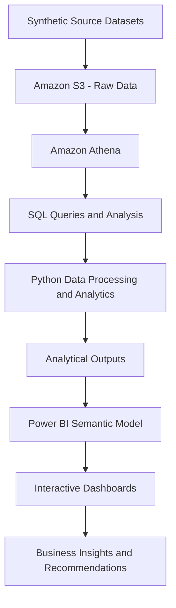
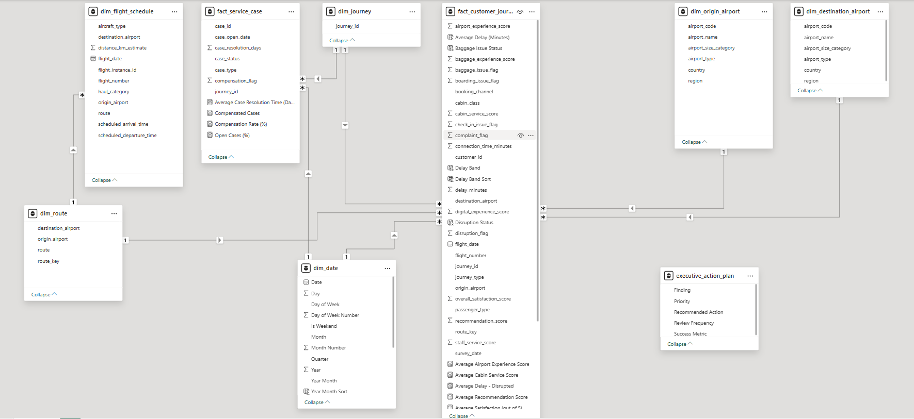

# ✈️ Airline Customer Experience Analytics

**End-to-End Analytics | AWS | SQL | Python | Power BI | Data Modelling**

An end-to-end analytics portfolio project investigating passenger satisfaction, flight delays, disruptions, complaints, service recovery and route performance. The project combines cloud-based data storage, SQL analysis, Python-based analytics, Power BI data modelling and business intelligence reporting.

> **Data disclaimer:** This project uses synthetic passenger and operational datasets for portfolio and analytical demonstration. Results do not represent actual airline performance.

## 📌 Project Overview

Airlines need to understand where customer experience deteriorates, which operational issues are associated with complaints, and where service improvements may have the greatest impact.

This project analyses 50,000 synthetic passenger journeys covering **1 July 2025 to 30 June 2026**. It demonstrates how datasets can be stored in the cloud, queried using SQL, analysed with Python and presented through interactive Power BI dashboards.

The project focuses on transforming data into meaningful KPIs, investigating relationships between operational performance and customer outcomes, and translating analytical findings into business recommendations.

## 🎯 Business Objectives

- Measure passenger satisfaction, complaint rates and disruption rates.
- Investigate how delay severity relates to customer satisfaction and complaints.
- Analyse baggage issues and their association with passenger outcomes.
- Evaluate service-case status, resolution duration and compensation.
- Compare customer outcomes across passenger segments and routes.
- Develop consistent KPIs and actionable operational recommendations.
- Demonstrate a cloud-based analytical workflow using Amazon S3, Amazon Athena, Python and Power BI.

## 📊 Dataset Overview

The project uses four synthetic datasets.

| Dataset | Records | Analytical purpose |
|---|---:|---|
| Customer Journey | 50,000 | Passenger journeys, satisfaction, delays, disruptions and complaints |
| Airport Reference | 27 | Airport identifiers and descriptive attributes |
| Flight Schedule | 29,200 | Flight schedule and route information |
| Service Cases | 878 | Customer-service cases, statuses, resolution and compensation |

**Reporting period:** July 2025 – June 2026.

The datasets support data-quality assessment, descriptive analytics, statistical investigation, KPI development and interactive reporting.

All records are synthetic and should not be interpreted as actual airline or passenger performance.

## 🏗️ Solution Architecture

The project follows an analytical workflow across four main layers:

1. **Data sources:** Passenger journeys, airport reference data, flight schedules and service cases.
2. **Cloud storage and SQL processing:** Source datasets are stored in Amazon S3 and queried using Amazon Athena.
3. **Analytics and modelling:** Python supports data inspection, validation, statistical analysis and analytical preparation.
4. **Business intelligence:** Power BI presents KPIs, trends, comparisons and business recommendations.

### AWS Data Pipeline Architecture

The project uses Amazon S3 for cloud data storage and Amazon Athena for SQL-based data analysis. Python is used for further data processing and analytical investigation.

The architecture below illustrates the implemented workflow at a high level, together with the reporting layer.



### Pipeline Components

| Layer | Technology | Responsibility |
|---|---|---|
| Source data | CSV / Excel datasets | Supply journey, airport, schedule and service-case data |
| Cloud storage | Amazon S3 | Store source datasets in the cloud |
| SQL processing | Amazon Athena | Query cloud-hosted data and perform SQL-based analysis |
| Data analysis | Python | Inspect, validate, process and analyse data |
| Reporting | Power BI | Present customer-experience KPIs, trends and comparisons |
| Business outputs | Dashboards and presentation | Communicate findings and recommendations |

**AWS Glue Data Catalog:** Document its role here once the catalog and tables used by the project have been confirmed. Athena commonly uses catalog metadata to identify tables and schemas, but the precise configuration should reflect your actual AWS setup.

The implemented components are Amazon S3 storage, Athena SQL analysis and Python-based analytical work. Any additional automation, curated-data publishing or direct Power BI-to-AWS integration should be documented separately if implemented.

## 🧩 Power BI Data Modelling

The Power BI report contains a multi-table analytical model that organises passenger journeys, service cases, flight schedules, airport attributes, routes and reporting dates.

The model separates journey-level and service-case-level facts from descriptive dimensions, supporting structured filtering, KPI calculations and business analysis.

### Fact Tables

| Table | Purpose |
|---|---|
| `fact_customer_journey` | Contains passenger journey attributes, satisfaction scores, delay minutes, disruption and complaint indicators, and service-experience metrics |
| `fact_service_case` | Contains service-case information, including case type, status, resolution duration and compensation indicators |

### Dimension Tables

| Table | Purpose |
|---|---|
| `dim_date` | Provides calendar attributes for date filtering and time-series analysis |
| `dim_journey` | Provides journey identifiers for linking journey-related records |
| `dim_flight_schedule` | Contains flight numbers, schedule dates, routes and scheduled departure and arrival times |
| `dim_route` | Provides route identifiers and origin/destination combinations |
| `dim_origin_airport` | Provides descriptive attributes for origin airports |
| `dim_destination_airport` | Provides descriptive attributes for destination airports |

### Business Action Table

| Table | Purpose |
|---|---|
| `executive_action_plan` | Organises findings into priorities, recommended actions, review frequency and success metrics |

These table names reflect the Power BI Model view for this project.

### Power BI Relationship Diagram

The model connects journey records with reporting dates, flight schedules, routes, airport dimensions and service-case data.



[View the full-size Power BI data model](docs/data-model.png)

### Data Modelling Principles

- **Define table grain:** Identify what one record represents in each fact and dimension table.
- **Validate keys:** Check uniqueness and referential integrity before establishing relationships.
- **Use a date dimension:** Support consistent daily, monthly, quarterly and yearly analysis.
- **Separate airport roles:** Use origin and destination airport dimensions for their respective airport attributes.
- **Maintain route consistency:** Use validated route keys for route-level comparisons.
- **Prevent double-counting:** Keep journey-level and service-case-level measures at their respective grains.
- **Validate relationships:** Review join columns, cardinality and filter direction in Power BI Model view.
- **Investigate unmatched records:** Validate flight and route matching before interpreting route-level results.

The exact join columns, relationship cardinalities and cross-filter directions should be documented from the actual Power BI model.

### Power BI Semantic Model and Measures

The report includes measures and analytical fields covering:

- Total passenger journeys
- Average satisfaction score
- Complaint rate
- Disruption rate
- Average delay in minutes
- Satisfaction by delay band
- Complaint rate by delay band
- Service-case volume and status
- Compensation rate
- Service-case resolution duration

DAX provides reusable measures and reporting logic, while Power Query supports data preparation. Measures should explicitly define their numerators, denominators and filter context to ensure consistent reporting.

## 📈 Key Findings

Initial analysis of the synthetic dataset produced the following baseline metrics.

| KPI | Result |
|---|---:|
| Passenger journeys | 50,000 |
| Average customer satisfaction | 3.74 / 5 |
| Overall complaint rate | 12.04% |
| Disruption rate | 12.10% |

Additional descriptive analysis identified the following patterns:

- Passenger satisfaction was lower among disrupted journeys.
- Complaint rates increased across more severe delay bands.
- Journeys delayed by more than 60 minutes showed substantially poorer customer outcomes.
- Service-case analysis identified open and pending cases for further investigation.
- Route comparisons require adequate sample sizes and validated flight matching.

These findings describe patterns in synthetic data. They do not establish causation or represent actual airline performance.

## 📊 Power BI Dashboard

The Power BI report contains five analytical pages.

| Dashboard page | Focus | Business question |
|---|---|---|
| Executive Overview | Core KPIs | What is the overall customer-experience baseline? |
| Flight Disruption & Delay Analysis | Delays and disruptions | How do operational disruptions relate to customer outcomes? |
| Customer Complaints & Service Recovery | Complaints and service cases | Where should customer-service teams investigate further? |
| Passenger Experience & Segmentation | Passenger and service segments | How do customer outcomes vary across available segments? |
| Route Performance & Customer Impact | Route comparisons | Which routes warrant additional investigation? |

The executive presentation summarises the business problem, analytical approach, findings, recommendations and action plan.

- **Power BI report:** [`powerbi/Airline_Customer_Experience_Analytics.pbix`](powerbi/Airline_Customer_Experience_Analytics.pbix)
- **Executive presentation:** [`presentation/Airline_Customer_Experience_Analytics.pptx`](presentation/Airline_Customer_Experience_Analytics.pptx)

The `.pbix` file can be opened using Power BI Desktop. GitHub stores the report file but does not render it as an interactive Power BI dashboard.

## 🐍 Python Analytics

The `python/` directory contains scripts for data loading, inspection, validation, statistical analysis and visualisation.

The scripts cover:

- Data inspection and validation
- Disruption analysis
- Delay analysis
- Complaint analysis
- Baggage analysis
- Cabin-class analysis
- Multivariable analysis
- Complaint-risk analysis
- Analytical visualisation
- Data export preparation for Athena

### Prerequisites

- Python and compatible package versions
- Git
- The required synthetic source datasets
- Power BI Desktop for opening the report
- Access to a compatible SQL execution environment

### Step 1 — Clone the Repository

```bash
git clone https://github.com/faisalnchohan786/airline-customer-experience-analytics.git
cd airline-customer-experience-analytics
```

### Step 2 — Create a Virtual Environment

On Windows:

```powershell
py -m venv .venv
```

Activate it using PowerShell:

```powershell
.venv\Scripts\Activate.ps1
```

### Step 3 — Install Dependencies

Run from the repository root:

```bash
py -m pip install -r python/requirements.txt
```

Use a Python version compatible with the packages listed in `python/requirements.txt`. Python 3.13 compatibility should be verified against the actual dependencies.

### Step 4 — Prepare the Data

Place the source datasets in the locations expected by the scripts. Review the data paths and configuration in the relevant Python files before execution.

The source datasets do not need to be committed to the public repository if they are large or unnecessary for reviewing the code. Any shared datasets must be synthetic or otherwise authorised for publication.

### Step 5 — Run Data-Quality Checks

The following are example commands. They assume the scripts support direct execution from the repository root and that their input paths have been configured correctly.

```bash
py python/data_inspection.py
py python/data_validation.py
py python/run_data_quality.py
```

### Step 6 — Run Analytical Scripts

For example:

```bash
py python/01_disruption_analysis.py
py python/02_delay_analysis.py
py python/03_complaint_analysis.py
```

Review each script's expected inputs, outputs and configuration before execution. Test the commands in a clean environment before describing the project as fully reproducible.

## 🗄️ SQL Analytics

The `sql/` directory contains scripts for structured analytical investigations, including:

- Data-quality checks
- Disruption analysis
- Delay severity analysis
- Complaint and baggage analysis
- Cabin-class and passenger-segment analysis
- Multivariable analysis
- Complaint-risk investigation
- Monthly trends and route performance

The SQL scripts can be executed in a compatible SQL environment. For Athena-based execution, confirm that the required database, tables, schemas and S3 locations are configured correctly.

The repository includes SQL scripts for analytical investigation; their publication does not by itself establish that every query has been executed successfully.

## ☁️ AWS Implementation and Future Enhancements

The project has implemented cloud storage using Amazon S3 and SQL-based analysis using Amazon Athena, with Python used for further data processing and analytical investigation.

The following enhancements can extend the workflow:

1. **Glue Data Catalog:** Document and validate catalog databases, tables and schemas where applicable.
2. **Curated data layer:** Publish validated analytical outputs to S3 in a query-efficient format such as Parquet.
3. **Data-quality controls:** Add repeatable checks for missing values, duplicate keys, data types and referential integrity.
4. **Power BI integration:** Configure and test a supported connection to curated analytical outputs if direct cloud reporting is required.
5. **Operational monitoring:** Introduce logging, refresh procedures, access controls and query-cost management.
6. **Automation:** Evaluate scheduled processing once the manual workflow is stable.

These enhancements should be marked as completed only after implementation and testing.

## 💼 Business Recommendations

The synthetic analysis suggests several areas to investigate with real operational data:

1. **Delay management:** Review extended delays and their association with customer satisfaction and complaints.
2. **Disruption communication:** Evaluate passenger communication and service recovery during disruptions.
3. **Case management:** Monitor open and pending cases, case ageing and resolution performance.
4. **Baggage experience:** Investigate the association between baggage issues, complaints and satisfaction.
5. **Route monitoring:** Compare routes using validated joins and adequate sample sizes.
6. **KPI governance:** Standardise definitions, refresh procedures and reporting logic.

These recommendations are hypotheses for further investigation, not evidence that a specific intervention will improve real-world outcomes.

## 🔍 Data Quality and Limitations

- All datasets are synthetic.
- Data-quality validation is required before relying on analytical results.
- Flight-number and route mismatches may affect route-level comparisons.
- Unresolved service cases require careful treatment in resolution-time calculations.
- Multiple service cases may relate to one journey, so table grain must be respected.
- Descriptive associations do not prove causation.
- Python execution commands and source paths must be tested for reproducibility.
- AWS capabilities beyond the confirmed S3, Athena and Python workflow should be documented according to their actual implementation status.

## 🚀 Future Enhancements

- Document the actual AWS configuration, database, tables and query workflow.
- Extend the S3–Athena workflow with validated curated datasets.
- Document the exact Power BI relationships, join keys and DAX measures.
- Add automated data-quality checks and reproducible analytical outputs.
- Include dashboard screenshots for recruiters who cannot open Power BI Desktop.
- Introduce scheduled refresh, monitoring and governance controls.
- Extend the analysis with validated statistical tests and carefully evaluated predictive models.

## 📁 Repository Structure

```text
airline-customer-experience-analytics/
├── README.md
├── docs/
│   ├── README.md
│   └── data-model.png
├── powerbi/
│   ├── README.md
│   └── Airline_Customer_Experience_Analytics.pbix
├── presentation/
│   ├── README.md
│   └── Airline_Customer_Experience_Analytics.pptx
├── python/
│   ├── README.md
│   ├── requirements.txt
│   └── Python analysis and validation scripts
└── sql/
    ├── README.md
    └── SQL analysis scripts
```

## 🧰 Technologies

- **Cloud storage:** Amazon S3
- **SQL analytics:** Amazon Athena and SQL
- **Programming and analysis:** Python, pandas and NumPy
- **Statistics and modelling:** SciPy, statsmodels and scikit-learn
- **Business intelligence:** Power BI, DAX and Power Query
- **Data modelling:** Fact tables, dimension tables and analytical relationships

## 👤 Project Purpose

This independent portfolio project demonstrates the application of cloud-based data access, data preparation, dimensional modelling, statistical investigation and business intelligence to a customer-experience problem.

It showcases analytical thinking, technical implementation and the translation of data into business-facing insights.

**Disclaimer:** This project uses synthetic data and is not affiliated with, endorsed by or representative of any specific airline.
